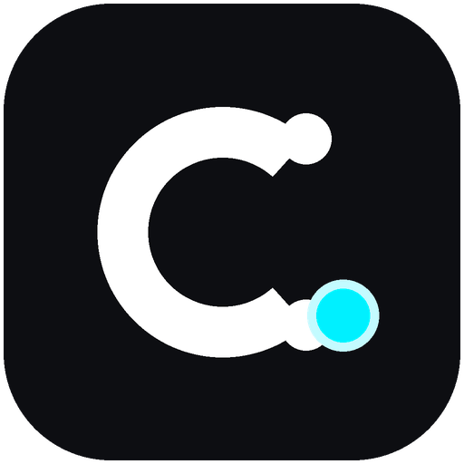
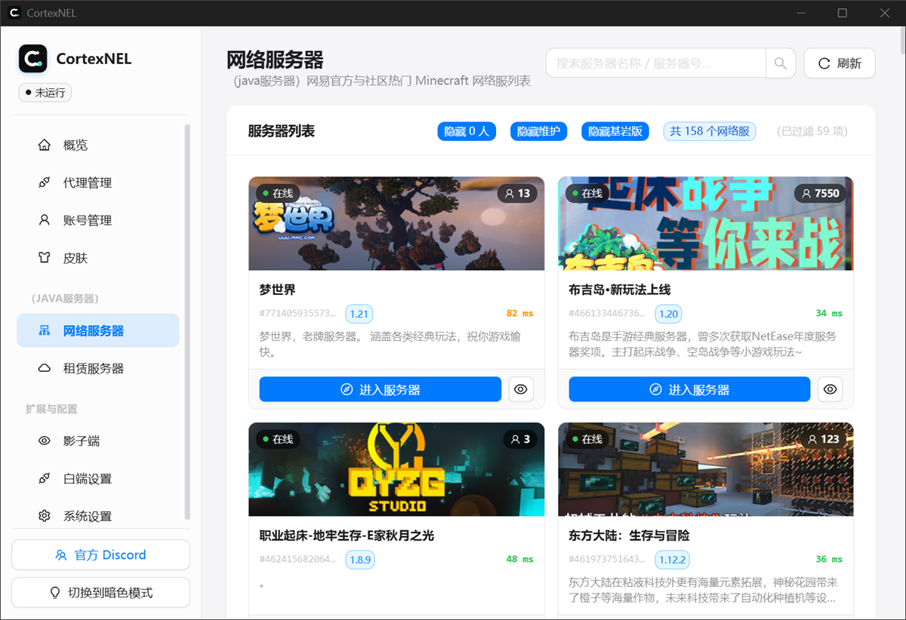
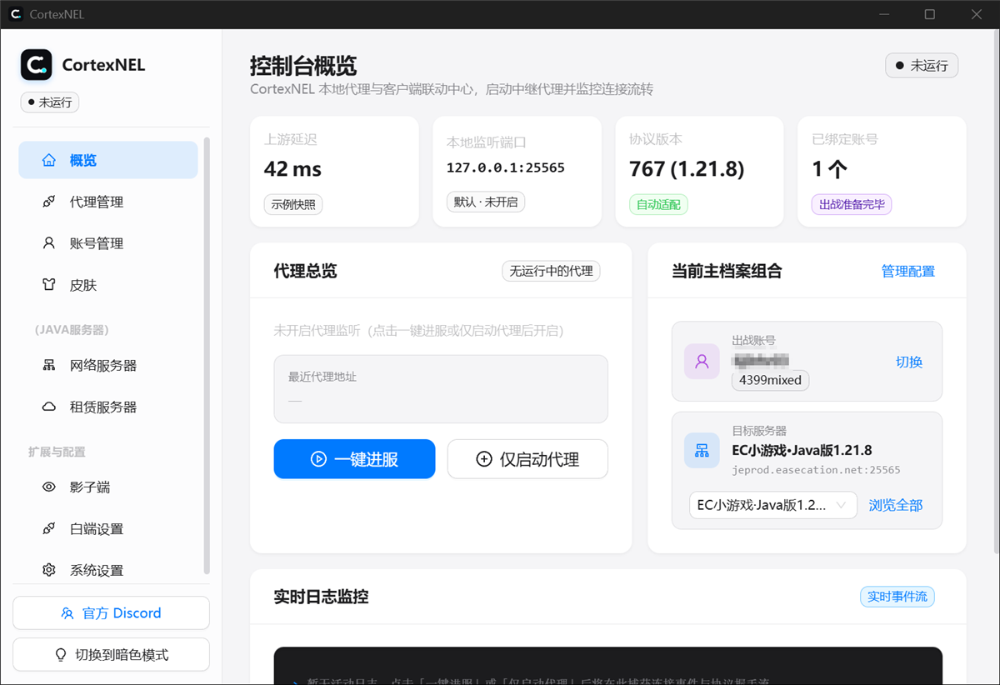
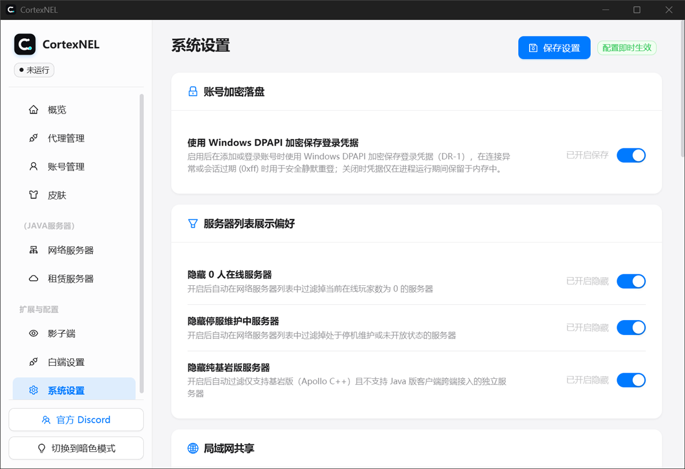

# CortexNEL

**用自己的账号，进自己的服务器。一次点击。**

<picture>
  <source media="(prefers-color-scheme: dark)" srcset="screenshots/servers-dark.png">
  
</picture>

## 这是什么

网易《我的世界》中国版的第三方启动器。你平时怎么玩还是怎么玩——但它把「登录 → 连服务器 → 开客户端 → 进服」这四步，压缩成一次点击。

官方启动器要求用官方客户端进官方服。CortexNEL 的做法不同：它在本机起一个代理，客户端连的是 `127.0.0.1`，真实服务器由代理去连。所以你可以用自己那份客户端，可以同时挂多个号，可以把一个服共享给同网段的朋友。

它不修改你的客户端文件，不注入进程，退出后原目录还是原样。

## 能做什么

- **一键进服** —— 选好账号和服务器，剩下的全自动。界面实时显示走到哪一步了。
- **多账号并存** —— 网易邮箱/手机号、4399 账号密码、Cookie 导入、小号机批量导入。代理会话可以多开，互不干扰。
- **服务器随手挑** —— 网络服与租赁服列表、详情、角色查询与创建、地址解析，一键进服。
- **局域网共享** —— 一个服同时给多台机器用，代理监听 `0.0.0.0`，防火墙一键放行。
- **客户端零污染** —— 按服生成独立运行沙盒，mods / config / options.txt 分层叠加，你原本的客户端目录不动一个字节。
- **配齐了的小工具** —— 皮肤检索与随机、白端 Mod 启停、角色随机命名（含同音字变形）。

## 三分钟开始

1. 到 [Releases](https://github.com/ATomyname/CortexNEL/releases) 下载 `CortexNEL.exe`，双击运行。
2. 「账号」页添加一个账号。
3. 「网络服务器」或「租赁服务器」页挑个服，点「一键进服」。

客户端路径和 Java 会自动探测，探不到就在「系统设置」里指定。只支持 Windows 10/11 x64。

> 还没发版的话，按 [docs/BUILDING.md](docs/BUILDING.md) 从源码编译。

## 界面

<table>
<tr>
<td width="50%">

**控制台概览**——会话状态、当前档案组合、实时日志

<picture>
  <source media="(prefers-color-scheme: dark)" srcset="screenshots/overview-dark.png">
  
</picture>

</td>
<td width="50%">

**系统设置**——凭据加密落盘、列表过滤、局域网共享

<picture>
  <source media="(prefers-color-scheme: dark)" srcset="screenshots/settings-dark.png">
  
</picture>

</td>
</tr>
</table>

明暗双主题，跟随系统。截图取自实际运行实例，账号名已打码，服务器列表为网易公开数据。

## 文档

| 文档 | 内容 |
|---|---|
| [docs/FAQ.md](docs/FAQ.md) | 进不去、版本不匹配、凭据存哪、局域网怎么开 |
| [docs/BUILDING.md](docs/BUILDING.md) | 环境要求、构建脚本、混淆发布、构建排错 |
| [docs/ARCHITECTURE.md](docs/ARCHITECTURE.md) | 模块地图、分层依赖、代理与代答机制、已知边界 |
| [docs/CONTRIBUTING.md](docs/CONTRIBUTING.md) | 门禁脚本、提交规范、代码约定、测试阶梯 |

## 提问之前先看这里

> **本项目完全开源免费，没有义务帮你解决任何问题。**
>
> 自己动手丰衣足食，有手有眼睛的别直接问。先使用百度、必应、豆包、DeepSeek、ChatGPT。
>
> GitHub 发 issue，或者直接修好给我发 PR。谢谢大家。
>
> 虽然不保证能维护。

真要提 issue，至少写清三件事：你做了什么、期望什么、日志面板里报了什么错。只写「不能用」「进不去」的会被直接关掉，这不是态度问题——没有信息我没法定位，问我也一样是猜。

## 社区

问题、想法、报 bug，来 [Discord](https://discord.gg/pvKnVDnJxN)。

## 相关项目

本项目是独立实现，但设计时对照过这个生态里几个先行项目的行为，特此致谢：

| 项目 | 作者 | 说明 |
|---|---|---|
| [Fantnel](https://github.com/NirvanaTec/Fantnel) | 涅槃科技 | 开源、含完整代理引擎，逻辑设计的主要对照来源 |
| [EastSideNEL](https://github.com/MC20018/EastSideNEL) | MC20018 | 借鉴其宿主分层与用例组织 |
| [RunNEL](https://github.com/MC20018/RunNEL) / [OpenNEL](https://github.com/MC20018/OpenNEL) | MC20018 | .NET + WinUI 启动器，作行为对照 |
| [Codexus.OpenSDK](https://github.com/denetease/Codexus.OpenSDK) | denetease | 开源协议 SDK，对照协议形状 |
| [NeteaseLauncher](https://github.com/Shadow3945/NeteaseLauncher) | Shadow3945 | 2019 年的早期实现，内存 Patch 路线 |

只对照行为与协议形状，没有复制代码。本项目的代理引擎、网易协议、启动编排全部是 Go 源码，构建过程不链接任何预编译二进制。

## 给个 Star

这个项目没有推广预算，没有运营团队，也没有商业计划。**Star 是它唯一能被更多人看到的方式。**

觉得能用，点个 Star；现在用不上，收藏着也行——代码都在这儿，随时来拿。

## 免责声明

**这不是官方产品。** CortexNEL 是第三方独立实现，与网易、Mojang、Microsoft 均无任何关联，未获授权，也未获认可。它不包含任何网易的游戏资源、客户端文件或私有数据。

### 账号与封号风险

用第三方启动器与代理进服，存在被服务端或反作弊系统判定为异常的可能，后果包括但不限于：连接被拒、角色数据异常、账号被临时或永久封禁。

**这个风险由你承担。** 作者无法、也不会为你解封、申诉、找回数据或做任何补偿。别拿你舍不得的主力账号来试。

### 使用后果自负

本项目按「现状」提供，不附带任何明示或暗示的担保，包括但不限于适销性、特定用途适用性与不侵权担保。因使用或无法使用本项目造成的任何直接或间接损失——账号损失、数据丢失、设备故障、时间成本、心情——作者一律不承担责任。

你下载、编译、运行本项目的动作本身，即表示你已理解并接受这一点。

### 数据与凭据

账号 token 默认只保留在进程内存中，退出即销毁。可选开启 DPAPI 加密落盘到 `%AppData%\CortexNEL`，用于会话过期后的静默重登。

但请自行评估：把凭据交给任何第三方程序都有风险。本项目的代码是公开的，你可以自己审计每一行——作者不为你的凭据安全背书。

### 开源完整度：约 99%

Java 线的实现基本完整开源，代理引擎、网易认证链、启动编排、运行沙盒、完整 UI 都在里面。

**没有开源的部分：**

| 未包含 | 原因 |
|---|---|
| 基岩版（PE）进服实现 | 该功能本身就没做完 |
| 内部设计文档与协议取证材料 | 含第三方逆向产物，不宜再分发 |
| 部分实验性探针工具 | 一次性的排查脚本，没有维护价值 |
| 影子端反检测组件 | 涉及反作弊对抗，不适合公开 |
| VMProtect 加固配置 | 与本项目功能无关的发布流程 |

这些缺失不影响 Java 线的构建与运行。想要基岩版支持的话，本仓库给不了，也不用问。

### 代码来源：vibecoding

**本项目的代码主要由 AI 编程助手生成**（vibecoding）。人类负责提需求、跑验证、做取舍、修被 AI 写崩的地方。

按通行的 AI 代码声明分级，这属于最彻底的 **Level 3**：整个项目由 AI 产出，人的输入是描述需求、审查结果、让它重写。

这意味着你需要预期：

- 代码风格、抽象层次、错误处理在模块之间不一致
- 存在未经充分验证的边界路径
- 注释与实现偶尔对不上
- 一些地方明显是"能跑就行"的写法

作者对代码的正确性、安全性、稳定性**不作任何保证**。

### 可能有 bug，请自己修

功能是能用的，但**小 bug 一定存在**。作者没有精力做完整回归测试，也没有义务响应每一个 issue。

发现问题的正确姿势：fork → 修 → 提 PR，或者干脆自己改了自己用。提 issue 仍然有价值（别人可能也踩到），但别期待及时回复，更别期待有人替你解决。

### 侵权处理

本项目不含任何网易的受版权保护资源，协议实现基于公开可观测的网络行为。若权利人认为本项目侵犯其权益，请通过 [Discord](https://discord.gg/pvKnVDnJxN) 或 issue 联系，作者核实后会立即处理，包括直接下架整个仓库。

### 关于商业使用

本项目以 Apache-2.0 发布，法律上允许商业使用。但作者**强烈不建议**：没有任何支持承诺，出问题没人兜底，把这类工具做成生意还会显著放大法律风险。真要做，请自行完成合规评估，别把责任推给这个仓库。

## 许可证

[Apache License 2.0](LICENSE)。版权所有 (c) 2026 CortexNEL。

许可证的免责条款与上面的声明互为补充，不冲突。
